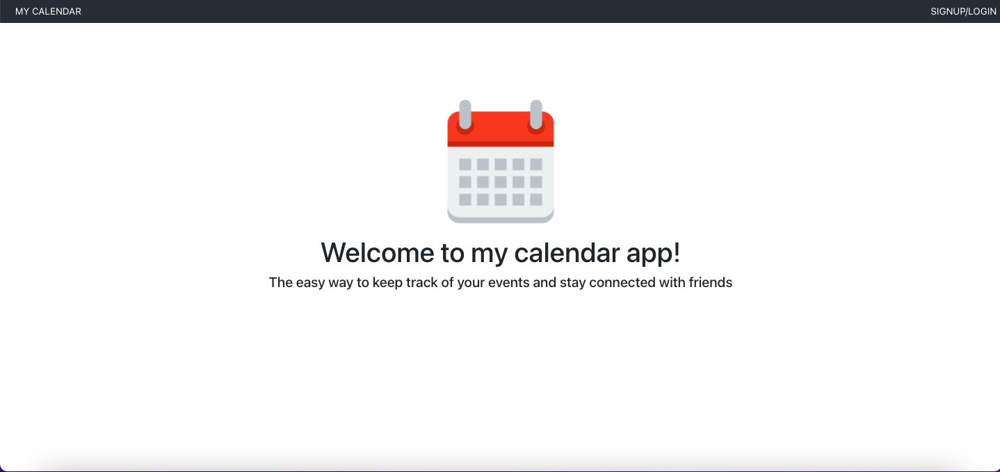
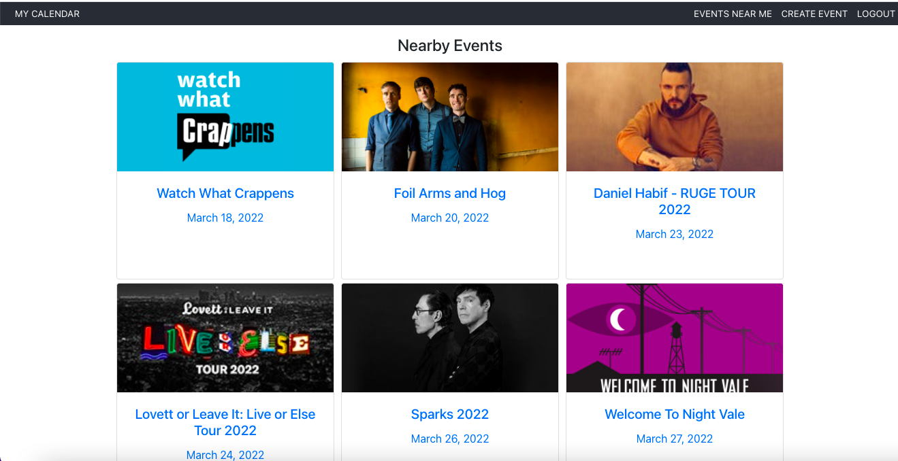

# My Calendar

[](https://github.com/kthib16/react-calendar-app/actions/workflows/ci.yml)

An event calendar built with React and Firebase. Sign in with Google, search for events through the Ticketmaster Discovery API, save them to your calendar, and create your own events.



## Features

- **Google sign-in** with Firebase Authentication. The session is restored on refresh, and calendar pages are only available to signed-in users.
- **Personal calendar** listing the events you are attending, soonest first, with a banner showing how many fall in the next seven days.
- **Event search** by ZIP code or keyword using the Ticketmaster Discovery API, with loading, empty and error states.
- **Create, edit and delete events**, stored in Cloud Firestore. Events from Ticketmaster can be added to your calendar with one click.
- **Event details** pulling live information (link, venue) from Ticketmaster for events that came from search.



## Tech stack

| Area | Tools |
| --- | --- |
| UI | React 17, React Router 5, Bootstrap 4, react-datepicker |
| Data and auth | Cloud Firestore, Firebase Authentication (Google provider) |
| External API | Ticketmaster Discovery API |
| Testing | Jest and React Testing Library |
| Tooling | Create React App (react-scripts 5), GitHub Actions |

## Getting started

### Prerequisites

- Node.js 16 or later (`.nvmrc` pins 18)
- A Firebase project with **Authentication** (Google provider enabled) and **Cloud Firestore**
- A free [Ticketmaster developer](https://developer.ticketmaster.com/) API key

### Setup

```bash
git clone https://github.com/kthib16/react-calendar-app.git
cd react-calendar-app
npm install
cp .env.example .env     # then add your keys
npm start                # http://localhost:3000
```

| Variable | Description |
| --- | --- |
| `REACT_APP_FIREBASE_KEY` | Web API key of your Firebase project |
| `REACT_APP_TICKETMASTER_API_KEY` | Ticketmaster Discovery API key |

The remaining Firebase settings (project ID, auth domain and so on) are in `src/firebase.js`. They identify the project and are not secrets, but you will want to replace them with the values from your own Firebase project settings.

Without `REACT_APP_FIREBASE_KEY` the app still loads and shows a message explaining what is missing.

### Firestore

Events live in a single `Events` collection. For development, rules that allow signed-in users to read and write are enough:

```
rules_version = '2';
service cloud.firestore {
  match /databases/{database}/documents {
    match /Events/{event} {
      allow read, write: if request.auth != null;
    }
  }
}
```

These rules are intentionally simple. See [Known limitations](#known-limitations) before using anything like this in production.

### Scripts

| Command | Description |
| --- | --- |
| `npm start` | Run the app in development |
| `npm test` | Run the test suite in watch mode (`CI=true npm test` runs once) |
| `npm run build` | Create a production build in `build/` |

## Project structure

```
src/
  App.js              Routing, auth state and Firestore reads/writes
  firebase.js         Firebase initialisation
  constants.js        Default event image and avatar
  Components/         Reusable pieces: EventItem, UpcomingEvents, DatePicker, StateSelect
  pages/              Route-level screens: Home, Login, MyCalendar, CreateEvent,
                      EditEvent, EventDetails, NearbyEvents
  utils/dates.js      Date parsing, formatting and "upcoming" logic (unit tested)
  data/states.js      State list for the event forms
```

### Data model

Each document in `Events` looks like this:

```js
{
  eventName: 'Jazz Night',
  date: '2026-11-20',                  // YYYY-MM-DD
  locationCity: 'New Orleans',
  locationState: 'Louisiana',
  image: 'https://…',
  ticketMasterId: 'vvG1…' | null,      // set when the event came from Ticketmaster
  isGoing: true,
  friendsGoing: [{ userName: 'me@example.com', profileImage: 'https://…' }]
}
```

## Testing

The suite covers the date utilities, the event list and alert components, the Ticketmaster response mapping, and the app shell (signed-out view, redirects for protected pages, signed-in navigation, and error handling). Firebase is mocked, so no credentials are needed.

```bash
CI=true npm test
```

GitHub Actions runs the tests and a production build on every push and pull request.

## Known limitations

- **Shared event collection.** The app loads every event and filters by attendee in the browser. That is fine for a demo, but a production version would query per user and enforce ownership in Firestore security rules.
- **Client-side API keys.** Create React App embeds `REACT_APP_*` values in the bundle, so the Ticketmaster key is visible to anyone using the site. Restrict it in the Ticketmaster dashboard or proxy requests through a small server.
- **No Firebase integration tests.** Reads and writes are exercised through mocks, not against the Firebase emulator.
- **Friends are placeholders.** `friendsGoing` records attendees, but there is no friend-management UI yet.

## Possible next steps

- Query events per user and tighten the Firestore rules
- Test against the Firebase Local Emulator Suite
- Move class components to function components with hooks
- Add a month view to the calendar
